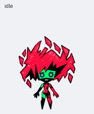
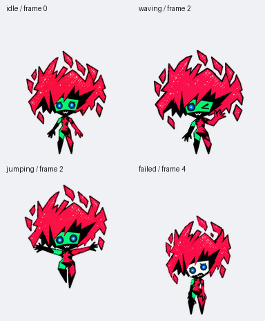

# Capri Desktop Pet

**Fragmented flame hair. A little AI with a color-changing face.**

An unofficial Capri-inspired companion asset project for ChatGPT / Pets workflows that support v2 sprite atlases. Includes a transparent sprite sheet, animation previews, generation briefs, and a portable Python utility for extracting and rebuilding frames.

[中文](README.md) · [Usage](docs/USAGE.md) · [Atlas format](docs/FORMAT.md) · [Artwork rights](ASSET_RIGHTS.md)



## Features

- Jagged red flame hair with intentional gaps and floating polygon fragments.
- Green face with a white-face failure reaction and blue circular digital eyes.
- Asymmetric red, black, and green body panels; independently drawn left/right movement.
- Nine animation states and sixteen clockwise gaze directions: 73 populated frames.

The host client provides the floating overlay, dragging, task-state changes, and pointer interaction. This repository supplies artwork and processing tools.

## Use the pet

Download [assets/spritesheet.png](assets/spritesheet.png) without resizing it. Import it through a Pets creation/import workflow that accepts the **1536 × 2288 v2 atlas**, then select the pet in your client. See the [OpenAI Pets documentation](https://learn.chatgpt.com/docs/pets) for current display controls.

Some interfaces accept only the older 1536 × 1872 v1 layout. Use a v2-capable workflow; resizing the image does not convert the schema. Account-specific pet IDs are not distributed with this repository.



[Gaze loop](previews/look-loop.gif) · [Idle–jump transition](previews/idle-jump-idle.gif) · [MP4 preview](previews/all-states.mp4)

## Edit the assets

Python 3.10+ is required only for the processing tool.

```bash
python -m pip install -r requirements.txt
python scripts/pet_assets.py validate assets/spritesheet.png
python scripts/pet_assets.py extract assets/spritesheet.png --out exported-frames
python scripts/pet_assets.py assemble exported-frames --out build/spritesheet.png
python -m unittest discover -s tests -v
```

The tool preserves complete cell pixels and alpha. It does not rescale, mirror, redraw, remove detached flame pieces, or overwrite existing outputs. Structural validation does not replace motion review or the official Pets import check.

## Creation and rights

The visuals were generated using OpenAI's built-in image generation tool and processed deterministically. Prompts describe the creative constraints; they do not guarantee identical regeneration. See [provenance](docs/PROVENANCE.md).

Code and written project documentation use the [MIT license](LICENSE). Character-derived artwork is excluded; read [ASSET_RIGHTS.md](ASSET_RIGHTS.md). Public availability does not grant rights to the original character or trademarks.

Unofficial fan project; no affiliation with or endorsement by CD PROJEKT RED, TRIGGER, Netflix, or OpenAI. Review the relevant rights holders' rules, including [CD PROJEKT RED's fan-content guidelines](https://www.cdprojektred.com/en/fan-content).

Contributions to animation, gaze readability, documentation, and tooling are welcome. See [CONTRIBUTING.md](CONTRIBUTING.md).
